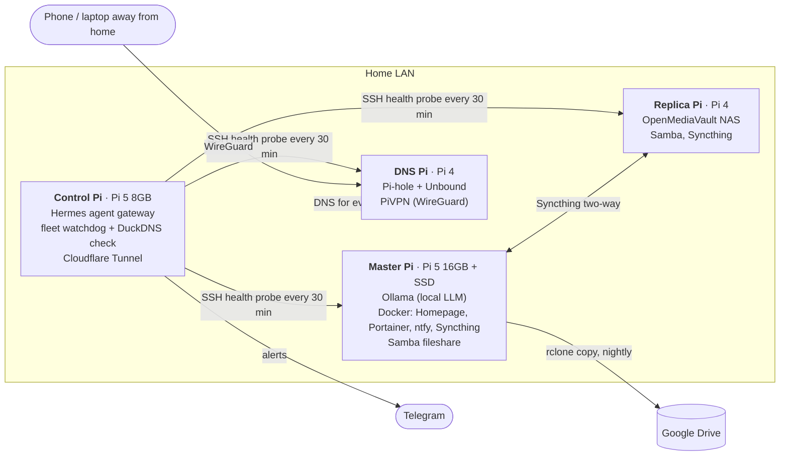

# pi-fleet

A four-node Raspberry Pi home lab: self-hosted file storage with a three-copy backup, network-wide
ad blocking with a private DNS resolver, a WireGuard VPN, local AI (Ollama), a status dashboard,
and a watchdog that only speaks up when something breaks.

It's run day to day by local AI agents (see [home-ai-agents](https://github.com/Sp0ctor/home-ai-agents)),
so everything here is built to be safe for an agent to operate: read-only health checks, alerts that
stay silent when healthy, and no secrets in any file.



| Node | Hardware | OS | Job |
|---|---|---|---|
| Control | Pi 5, 8 GB | Debian 13 | Runs the Hermes agent gateway, the fleet watchdog and the DDNS check; the only machine holding the fleet SSH key |
| Master | Pi 5, 16 GB, 118 GB SSD | Ubuntu 25.10 | Ollama, Docker services, primary fileshare, nightly cloud backup |
| Replica | Pi 4, 2 GB, 118 GB USB drive | OpenMediaVault (Debian 12) | Second copy of the fileshare (NAS) |
| DNS | Pi 4, 8 GB | Raspberry Pi OS (Debian 12) | Pi-hole ad blocking, Unbound recursive DNS, PiVPN WireGuard server |

## What's in here

```
controller/
  scripts/pi_fleet_health_check.py   silent-on-healthy watchdog: disk, failed services, temperature,
                                     undervoltage, Pi-hole and Ollama state; alerts on change + recovery
  scripts/duckdns_health_check.py    checks public IP vs. the DuckDNS record via two DoH resolvers
  scripts/pi-fleet-status            one-shot status of every node (OS, uptime, disk, pending updates)
  systemd/                           user units: agent gateway, dashboard, Cloudflare Tunnel
master/
  docker/homepage/                   read-only fleet dashboard (no credentials, no action buttons)
  docker/monitoring/                 Uptime Kuma + Netdata (+ optional Suricata IDS)
  docker/ntfy/                       self-hosted push notifications
  docker/syncthing/                  fileshare replication to the replica
  docker/mariadb/                    MariaDB + Adminer (passwords from .env)
  docker/unbound/                    containerized Unbound
  scripts/backup-nas-to-gdrive       nightly, locked, non-destructive rclone copy
  crontab.example
dns/README.md                        Pi-hole + Unbound + PiVPN setup notes
nas/README.md                        OpenMediaVault replica notes
docs/runbooks/                       how problems were actually diagnosed and fixed
```

## Design choices

- **Three copies of the files.** Master SSD → replica NAS (Syncthing, two-way) → Google Drive
  (`rclone copy`, which never deletes on the far side). See [the backup runbook](docs/runbooks/three-copy-backup.md).
- **Quiet monitoring.** The watchdog stores the current set of problems and prints only what changed,
  so a healthy fleet produces zero messages. Empty output = no Telegram message.
- **One key, one place.** Only the control Pi holds the fleet SSH key; probes use `BatchMode`,
  `IdentitiesOnly` and strict host-key checking. The dashboard never sees a credential.
- **Private DNS.** Pi-hole forwards to a local validating Unbound resolver instead of a third-party DNS provider.
- **No open ports for the website.** A Cloudflare Tunnel publishes it outbound-only.
- **Agent-safe.** Every script is either read-only or does exactly one bounded thing, and fails loudly instead of guessing.

## Using it

1. Edit the IPs in `controller/scripts/pi_fleet_health_check.py` and `pi-fleet-status` (examples use `192.168.1.x`).
2. Put the fleet key on the control Pi only: `~/.ssh/pi-fleet-keys/id_ed25519` (or set `PI_FLEET_KEY`).
3. Run the watchdog twice by hand. A healthy fleet prints nothing both times. Then schedule it every 30 minutes.
4. For each Docker service: `cd master/docker/<name> && docker compose up -d`
   (MariaDB: `cp .env.example .env` and set real passwords first).

## Security

See [SECURITY.md](SECURITY.md). Run `./scan_before_push.sh` before every push.

MIT licensed.
